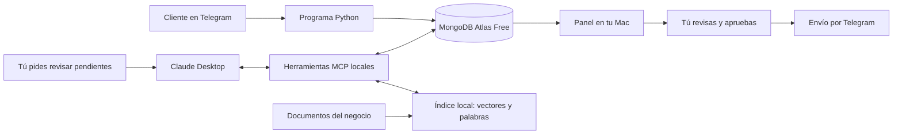

# Zentra · AIEC · Atención con Claude y RAG local

Asistente para una agencia ficticia: recibe mensajes privados de texto en Telegram, los guarda en MongoDB y permite preparar borradores desde Claude Desktop mediante MCP. El usuario revisa y envía cada respuesta desde un panel local.

**Claude redacta, con tu cuenta gratuita y sin llamadas a su API de pago.** Se utilizan un bot normal de Telegram y MongoDB Atlas Free. Dos modelos locales gratuitos se encargan exclusivamente de buscar información y ordenar fragmentos; no sustituyen a Claude. La Mac debe estar encendida y conectada a internet para Telegram, Atlas y Claude. Esto es atención asistida: debes pedirle a Claude que procese las solicitudes.

## Probar el panel sin conectar cuentas

Instala Python 3.12 o posterior y [uv](https://docs.astral.sh/uv/getting-started/installation/). Después ejecuta:

```bash
git clone https://github.com/Israeljuarezjimenez/zentra-aiec.git
cd zentra-aiec
uv sync --locked
.venv/bin/python -m aiec demo
```

Abre <http://127.0.0.1:5050>. La demo utiliza ejemplos en memoria, no Claude ni Atlas. Ningún mensaje puede enviarse y los cambios desaparecen al cerrar. Hay un borrador ilustrativo en la conversación de Mateo.

En macOS también puedes abrir **Demo.command** después de instalar las dependencias. Para probar el buscador documental por separado, detén la demo con Control+C y ejecuta:

```bash
.venv/bin/python -m aiec load-examples
.venv/bin/python -m aiec rag-index
.venv/bin/python -m aiec rag-search "¿Qué incluye Publicidad Arranque?"
```

Estos tres comandos no necesitan credenciales de Telegram, Atlas o Claude. `load-examples` copia los 19 documentos ficticios públicos a tu carpeta local `knowledge/` y conserva cualquier archivo que ya exista. La primera preparación descarga los modelos; las búsquedas posteriores se ejecutan localmente. Esta prueba devuelve fragmentos, no genera una respuesta de Claude.

## Configurar las cuentas reales, paso a paso

### 1. Instalar y preparar

Para otra computadora: instala Python 3.12 o posterior y [uv](https://docs.astral.sh/uv/getting-started/installation/), abre una terminal en esta carpeta y ejecuta:

```bash
uv sync --locked
.venv/bin/python -m aiec setup
.venv/bin/python -m aiec load-examples
```

`uv` instala las bibliotecas en `.venv`, una carpeta aislada para este proyecto. `setup` crea `.env` con permisos privados y una clave de sesión. No reemplaza tus credenciales si ya existen. `load-examples` instala las fichas ficticias de demostración sin reemplazar documentos existentes.

### 2. Crear el bot de Telegram

1. Abre [@BotFather](https://t.me/BotFather) en Telegram; comprueba el nombre exacto.
2. Escribe `/newbot` y sigue sus instrucciones. El nombre de usuario debe ser único y terminar en `bot`.
3. Copia el token. Es una llave de acceso, no un crédito de pago.
4. Abre el archivo `.env` de esta carpeta con tu editor y completa `TELEGRAM_BOT_TOKEN=`. No pegues el token en el chat, una captura o GitHub.

### 3. Conectar tu MongoDB Atlas

1. En Atlas selecciona el clúster **Free** (antes M0), sin ampliar a un nivel de pago.
2. En **Database Access**, crea un usuario de base de datos con permiso `readWrite` sobre la base `aiec`. Es distinto a tu cuenta de acceso a Atlas.
3. En **Network Access**, añade tu IP actual. Si cambia, actualízala aquí.
4. Pulsa **Connect → Drivers → Python** y copia la cadena de conexión.
5. Sustituye los marcadores de usuario y contraseña. Los caracteres especiales de la contraseña deben estar codificados para una URL; sigue la ayuda de Atlas al copiar la conexión.
6. Pégala después de `MONGODB_URI=` en `.env`. Deja `MONGODB_DATABASE=aiec`.

El archivo quedará con estas variables, además de la clave generada automáticamente:

Si necesitas añadir o corregir la contraseña en la cadena guardada, abre **Configurar MongoDB.command** con doble clic. Te pedirá la contraseña en una terminal sin mostrarla, la colocará en la conexión codificando los caracteres especiales y comprobará MongoDB y Telegram. No tienes que editar la contraseña directamente en la cadena.

```dotenv
TELEGRAM_BOT_TOKEN=TU_TOKEN_DE_BOTFATHER
MONGODB_URI=mongodb+srv://USUARIO:CONTRASENA@TU_CLUSTER/?retryWrites=true&w=majority
MONGODB_DATABASE=aiec
```

**No envíes este archivo a nadie.** `.gitignore` ya lo excluye. Usa una base `aiec` distinta para cada bot.

### 4. Verificar las conexiones

```bash
.venv/bin/python -m aiec doctor
```

Comprueba MongoDB, los índices, el token y que el bot no tenga otra integración activa. No envía mensajes. Si falla, muestra una indicación sin imprimir tus credenciales.

### 5. Conectar Claude Desktop

1. Instala [Claude Desktop](https://claude.com/download) e inicia sesión con tu cuenta gratuita.
2. Ejecuta:

   ```bash
   .venv/bin/python -m aiec claude-config
   ```

3. En Claude Desktop abre **Settings → Developer → Edit Config**. En Mac el archivo suele ser `~/Library/Application Support/Claude/claude_desktop_config.json`. Los nombres pueden variar con el idioma o versión.
4. Copia el bloque `aiec` del resultado dentro de `mcpServers`. Si ya tienes otros servidores, consérvalos: no reemplaces el archivo completo.
5. Cierra Claude Desktop por completo con `⌘Q` y vuelve a abrirlo.
6. Verifica que aparezcan las herramientas AIEC y pídele: **«Consulta el catálogo de AIEC»**.

La configuración generada contiene rutas a esta carpeta, no tus contraseñas. Si mueves el proyecto, vuelve a generarla. También está en `.runtime/claude_config.json` después de `setup`.

### 6. Preparar el conocimiento del negocio

```bash
.venv/bin/python -m aiec rag-index
```

La primera ejecución descarga dos modelos públicos con revisiones fijadas. No requiere cuenta, tarjeta ni claves de pago. Las siguientes actualizaciones y búsquedas usan los modelos guardados en la Mac. Se incluye automáticamente `aiec/catalog.json`, con nueve planes y honorarios de referencia propuestos para la agencia ficticia de demostración.

### 7. Iniciar y atender

Abre **Iniciar.command** o ejecuta:

```bash
.venv/bin/python -m aiec run
```

Esto inicia el receptor de Telegram y el panel en <http://127.0.0.1:5050>. Mantén esa terminal abierta. Ejecuta solo una instancia del receptor.

1. Abre tu bot desde Telegram y envíale una solicitud de texto. Los clientes deben iniciar la conversación con el bot.
2. El programa guarda el mensaje y trata de enviar una confirmación fija de recepción. Esa confirmación no usa IA.
3. En el panel pulsa **Actualizar**. Verás la conversación pendiente.
4. En Claude Desktop escribe:

   > Revisa mis solicitudes pendientes con las herramientas AIEC. Consulta el catálogo y lee cada solicitud con su contexto RAG. Guarda el borrador con rag_context_id y fuentes literales de los fragmentos utilizados. Si falta evidencia documental, regístralo en missing_data. Propón opciones sin preguntas al cliente, usa MXN por defecto y no inventes precios o disponibilidad. No envíes mensajes; indícame qué revisar en el panel.

5. Autoriza a Claude a usar las herramientas cuando su aplicación lo solicite.
6. Actualiza el panel, abre la solicitud y revisa el análisis y la respuesta. Puedes editar el texto.
7. Marca que revisaste el destinatario y pulsa **Aprobar y enviar por Telegram**.
8. La respuesta queda en el historial. Si el cliente escribe otra vez, se invalida el borrador anterior y la conversación vuelve a pendiente.

Para detener el receptor y el panel, pulsa **Control+C** en su terminal. Claude Desktop inicia su conexión MCP por separado cuando la necesita.

Si aparece «Address already in use» o «puerto 5050 ocupado», cierra primero la demo o la otra instancia de AIEC con **Control+C** en su terminal. Después ejecuta `run` otra vez. El panel y la demo comparten puerto; el receptor de Telegram solo se inicia cuando AIEC consigue reservarlo.

## Qué hace cada parte



**Las herramientas MCP no pueden enviar ni aprobar respuestas.** El envío requiere una acción en el panel. Esta separación impide que una instrucción incluida en el mensaje de un cliente se convierta directamente en un envío.

Herramientas de Claude:

| Herramienta | Función |
| --- | --- |
| `consultar_catalogo` | Leer servicios y reglas del negocio. |
| `listar_solicitudes` | Consultar un máximo de 20 solicitudes por llamada; por defecto 5. |
| `obtener_solicitud` | Leer los últimos 20 mensajes, revisión y contexto RAG vinculado a esa conversación. |
| `buscar_conocimiento` | Buscar información del negocio por significado y palabras; no consulta conversaciones. |
| `guardar_borrador` | Validar contexto y citas, y guardar el análisis y la respuesta pendiente de aprobación. |

El número de **revisión** cambia con cada mensaje nuevo del cliente. Evita guardar o enviar una respuesta preparada para un historial anterior.

## RAG documental local

En el panel abre **Conocimiento**. Importa archivos **PDF con texto, Markdown (.md) o texto UTF-8 (.txt)** con servicios, tarifas vigentes, condiciones y preguntas frecuentes aprobadas. La importación prepara la base automáticamente. Para actualizar un archivo del mismo nombre, marca **Reemplazar**; se conserva una copia privada de la versión anterior. También puedes copiar, editar o retirar archivos de `knowledge/` y pulsar **Actualizar base**. Los documentos de esa carpeta están excluidos de Git.

### Catálogos y planes preparados

Se distribuyen 19 documentos ficticios en `examples/knowledge/`, fechados el 15 de octubre de 2026: guía general, tres catálogos de servicio, nueve fichas individuales y seis documentos de presupuestos, requisitos, entregas, cotización, preguntas frecuentes y estilo de atención. El comando `load-examples` los copia a `knowledge/` para que el RAG los consulte. El JSON estructurado incluye los mismos nueve planes y enlaza a sus fichas.

| Servicio | Plan | Honorario de referencia propuesto | Periodo |
| --- | --- | ---: | --- |
| Publicidad | PUB-A · Publicidad Arranque | $3,500 MXN | Mensual |
| Publicidad | PUB-C · Publicidad Crecimiento | $5,500 MXN | Mensual |
| Publicidad | PUB-E · Publicidad Escala | $8,500 MXN | Mensual |
| Contenido | CON-P · Contenido Presencia | $2,900 MXN | Mensual |
| Contenido | CON-C · Contenido Constancia | $4,900 MXN | Mensual |
| Contenido | CON-I · Contenido Integral | $6,900 MXN | Mensual |
| Sitio web | WEB-E · Web Esencial | $6,500 MXN | Por proyecto |
| Sitio web | WEB-N · Web Negocio | $11,000 MXN | Por proyecto |
| Sitio web | WEB-C · Web Catálogo | $17,500 MXN | Por proyecto |

Son referencias de demostración elaboradas para este proyecto, no tarifas verificadas ni aprobadas de una agencia real. La inversión publicitaria, los gastos externos, el tratamiento fiscal y el total definitivo se precisan en la cotización. La carga de estas fichas no compra servicios ni cambia el costo de funcionamiento de Zentra. Claude puede recomendarlas como propuestas orientativas respaldadas por sus fuentes.

Cada ficha especifica entregables, exclusiones, revisiones y tiempos estimados. Los catálogos permiten comparar planes; la guía de presupuestos separa honorarios de pauta y conserva si el monto del cliente es total o mensual. Por ejemplo, el escenario de $10,000 MXN totales propone $3,500 para gestión, $5,000 para anuncios y $1,500 todavía sin asignar hasta completar los conceptos de la cotización; la reserva no equivale a un impuesto calculado.

Puntos de entrada: [guía del catálogo](<examples/knowledge/00 Guia del catalogo.md>), [publicidad](<examples/knowledge/01 Catalogo de publicidad.md>), [contenido](<examples/knowledge/02 Catalogo de contenido.md>) y [sitios web](<examples/knowledge/03 Catalogo de sitios web.md>). Para darles uso comercial real, actualiza identidad, alcances y condiciones en tus copias locales y prepara de nuevo el índice. Mantén los ejemplos públicos libres de información privada.

El recorrido es:

1. Extraer texto conservando la página de cada PDF. Los escaneos sin texto y los PDF con contraseña se rechazan con una indicación para corregirlos; no se realiza reconocimiento de imágenes.
2. Dividir por párrafos; si un bloque es largo, usar ventanas de 300 tokens con 45 de solapamiento. Un token es una pieza de texto que procesa el modelo. Se limita también el título y la consulta para evitar cortar silenciosamente los fragmentos.
3. Crear vectores con **multilingual-e5-small**, un modelo que representa el significado en español y otros idiomas. Usa ONNX cuantizado y dos hilos de CPU. Solo se recalculan los fragmentos de documentos modificados.
4. Combinar búsqueda semántica con **BM25** de SQLite FTS5, que favorece palabras exactas. Las listas se combinan mediante fusión de rangos recíprocos (RRF).
5. Revisar hasta 20 candidatos con **mMARCO MiniLM multilingüe**, un segundo modelo que compara pregunta y fragmento juntos. Se aplican umbrales de similitud y relevancia y un margen respecto del mejor resultado para reducir ruido. Se eliminan duplicados y se limita cada fuente a dos fragmentos. Claude recibe hasta cinco fragmentos, con un presupuesto total de 7,000 caracteres.
6. Al leer una solicitud, recuperar automáticamente información usando los últimos mensajes del propio cliente. Cada contexto queda vinculado a su identificador y revisión. Una búsqueda general no permite guardar el borrador de un cliente.
7. Al guardar, exigir `rag_context_id` y citas `chunk_id` + `quote` que pertenezcan a los resultados recuperados. Las citas se muestran en el análisis del panel. Si no se encontró evidencia, se exige registrar la limitación internamente.

Claude puede repetir `obtener_solicitud` con una `consulta_conocimiento` más concreta basada en el historial cuando la consulta inicial sea ambigua o demasiado breve. El nuevo contexto sigue vinculado al mismo cliente y revisión.

MongoDB conserva las conversaciones y las citas del borrador. El índice documental se guarda en `.runtime/rag/knowledge.sqlite3`: SQLite funciona dentro del programa y no necesita otro servidor o suscripción. Sus vectores se buscan con NumPy; para esta base pequeña se utiliza búsqueda exacta, sin un índice aproximado adicional. Los modelos se cargan cuando hacen falta y se reutilizan. La Mac debe conservar tanto los documentos como el índice para usarlos desde otro proceso local.

El contenido de los documentos no se envía a un proveedor para calcular vectores o reordenar resultados. **Los fragmentos recuperados sí se comparten con Claude Desktop al utilizar sus herramientas**, como contexto para redactar. Las conversaciones privadas no se añaden al corpus documental. Los contextos recientes se guardan en el índice privado con fines de validación; se conservan como máximo 500.

Si los archivos cambian, se exige actualizar la base. Una actualización que cambia contenido invalida los contextos anteriores y bloquea el envío de borradores preparados con versiones viejas. En la solicitud usa **Actualizar borrador con Claude**. Esto no envía mensajes automáticamente.

Límites locales: 10 MB por archivo, 200 páginas por PDF, 200 documentos incluidos el catálogo y 10,000 fragmentos. Una falla al extraer o calcular vectores conserva el índice anterior; si las fuentes cambiaron, las consultas quedan pendientes hasta actualizarlo correctamente.

Las citas verificadas prueban que el texto existe en una fuente recuperada, **no que todas las conclusiones de Claude sean correctas**. Los umbrales pueden omitir documentos relevantes; fuentes contradictorias o sin vigencia requieren revisión. Mantén información vigente, identifica las fechas en tus documentos y valida preguntas reales antes de usar tarifas o compromisos. Los precios de los materiales incluidos están identificados como referencias de demostración.

Comandos opcionales, ejecutados desde AIEC:

```bash
# Preparar o actualizar; conserva los vectores que no cambiaron.
.venv/bin/python -m aiec rag-index

# Consultar el estado y las fuentes indexadas.
.venv/bin/python -m aiec rag-status

# Ver los fragmentos que devuelve una pregunta.
.venv/bin/python -m aiec rag-search "¿Qué ofrecemos para atraer clientes?"

# Evaluar los modelos reales con documentos ficticios en un índice temporal separado.
.venv/bin/python -m aiec rag-eval
```

`rag-eval` mide recuperación y rechazo de consultas ajenas; no llama a Claude ni evalúa la redacción final. Incluye casos de desarrollo y preguntas adicionales de validación, con su propio catálogo fijo para que editar la oferta del negocio no altere la prueba. Su resultado es una prueba pequeña y reproducible, no una garantía de precisión para cualquier documento. Los datos de evaluación no se incorporan a la base real.

## Precisión y límites de esta primera versión

- La agencia y el catálogo son ficticios; actualiza `aiec/catalog.json` y los documentos de `knowledge/` antes de usarlos como información de un negocio real. Los nueve planes tienen honorarios de referencia propuestos para la demostración; no son cotizaciones finales ni tarifas reales aprobadas. Los importes se interpretan en MXN salvo otra moneda explícita y se respeta el periodo indicado (por ejemplo, presupuesto total). Si faltan datos, se anotan internamente; las respuestas al cliente ofrecen opciones sin preguntas. Cualquier alcance o duración sugeridos se identifican como propuesta, no como acuerdo.
- El análisis exige servicio, resumen, prioridad justificada y citas literales presentes en el mensaje. Esto ayuda a revisar el resultado, pero no garantiza que toda interpretación de Claude sea correcta.
- Una conversación por cliente; hasta 100 mensajes de historial por conversación, incluyendo respuestas aprobadas. Los anteriores se descartan para limitar almacenamiento. Claude recibe los últimos 20 en cada consulta. Está pensado para una demo o uso pequeño, no como archivo completo de atención.
- Solo mensajes privados de texto. Los grupos, audios, fotos y ediciones de mensajes no se procesan. Telegram conserva las actualizaciones no recogidas por un máximo de 24 horas.
- Los mensajes se deduplican antes de crear borradores; el punto de lectura se guarda en MongoDB. La confirmación fija de recepción es un intento único: un fallo de red puede impedir que llegue, aunque el mensaje sí esté guardado.
- Un nuevo mensaje invalida el borrador anterior. Dos clics o dos pestañas no pueden reclamar el mismo borrador para enviarlo dos veces.
- Si Telegram no confirma un envío, no se reintenta automáticamente. El panel exige verificar con el destinatario si se entregó. Si el proceso se cierra justo después de enviar, puede quedar como «enviando» y también requerir verificación. No se promete entrega exactamente una vez ante cualquier fallo externo.
- El panel solo escucha en la propia Mac y sus formularios tienen protección contra solicitudes ajenas. No debe publicarse en internet en esta configuración.
- No se incluyen métricas de ahorro inventadas, procesamiento autónomo de Claude ni acceso a su API. El consumo de la cuenta gratuita puede agotarse; en ese caso esperas a su renovación.

## Pruebas

```bash
uv run pytest -q
```

Las pruebas usan una base simulada y un transporte HTTP de prueba: no usan Atlas, no llaman a Claude y no envían mensajes. Incluyen deduplicación, revisiones, aprobación, fallos de envío, comunicación real del protocolo MCP y controles RAG (citas, aislamiento, versiones, PDF, importación y actualizaciones atómicas). Los tests unitarios usan dobles de los modelos para verificar integridad sin descargarlos; `rag-eval` usa los modelos locales reales para medir recuperación.

## Archivos públicos y privados

El repositorio incluye código, pruebas, `uv.lock`, una plantilla `.env.example` sin credenciales y los documentos ficticios de `examples/knowledge/`.

Permanecen en la computadora y se excluyen de Git: `.env` y sus variantes privadas, `.runtime/` (bases, contextos, modelos, registros y capturas), los documentos de trabajo de `knowledge/`, entornos virtuales, claves privadas y configuración local de Claude Desktop. Las conversaciones de clientes permanecen en la base configurada y no se exportan al repositorio. Cada persona que clone el proyecto configura sus propias cuentas.

## Diccionario breve

| Término | Significado |
| --- | --- |
| IA | Inteligencia artificial; Claude analiza los mensajes y prepara propuestas. |
| MCP | Protocolo de Contexto del Modelo; conecta Claude con nuestras funciones. |
| API | Interfaz para que se comuniquen programas; aquí usamos la de Telegram, no la API de Claude. |
| Base de datos / DB | Lugar organizado para guardar la información. |
| Atlas | Servicio de MongoDB en internet. |
| Token | Llave privada que permite controlar el bot. |
| Borrador | Propuesta que todavía no se envió al cliente. |
| Terminal | Aplicación donde ejecutas los comandos del proyecto. |
| RAG | Generación aumentada por recuperación: buscar información relevante antes de redactar. |
| Vector o embedding | Lista de números que representa el significado de un fragmento para compararlo con una consulta. |
| Índice | Estructura preparada para buscar los fragmentos de tus documentos. |
| Búsqueda híbrida | Combina significado con coincidencias de palabras. |
| Reranker | Modelo que revisa y reordena los resultados más prometedores según la pregunta. |

Referencias del RAG: [FastEmbed y ONNX local](https://github.com/qdrant/fastembed), [multilingual E5](https://arxiv.org/abs/2402.05672), [recuperar y reordenar](https://sbert.net/examples/sentence_transformer/applications/retrieve_rerank/README.html), [mMARCO](https://arxiv.org/abs/2108.13897), [SQLite FTS5](https://www.sqlite.org/fts5.html).

Referencias: [Telegram Bot API](https://core.telegram.org/bots/api), [MongoDB Atlas Free](https://www.mongodb.com/docs/atlas/tutorial/deploy-free-tier-cluster/), [MCP en Claude Desktop](https://support.claude.com/en/articles/10949351-getting-started-with-local-mcp-servers-on-claude-desktop), [planes de Claude](https://claude.com/pricing).
