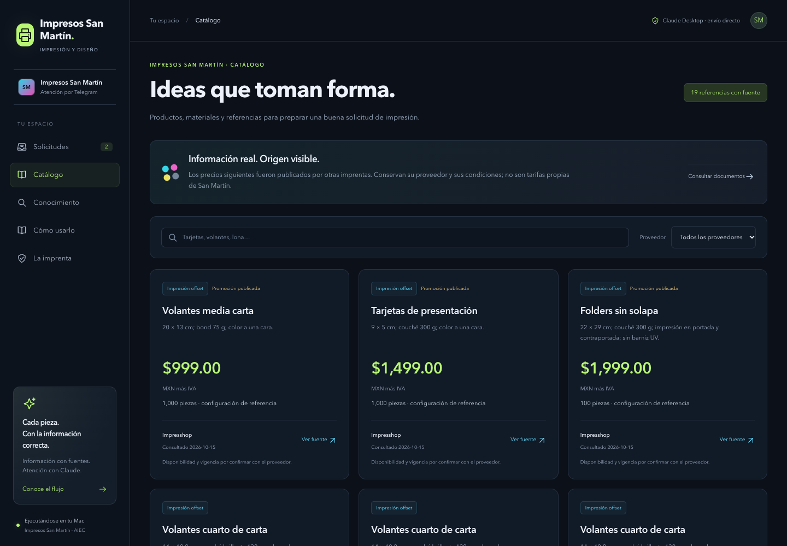
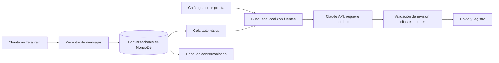

# Impresos San Martín · Atención por Telegram

Panel local para recibir consultas de imprenta por Telegram, conservar conversaciones en MongoDB y consultar catálogos mediante RAG. **Claude es el único motor de redacción configurado.** El panel muestra historial, fuentes y estado de entrega, sin botones de aprobación de respuestas.

**Flujo principal:** el cliente escribe por Telegram; Claude Desktop lee la solicitud mediante MCP, redacta y llama a `responder_cliente`. La herramienta valida las fuentes y envía el mensaje directamente al destinatario, sin aprobación en el panel. Funciona con la conexión de Claude Desktop ya configurada y no consume la API de pago.

Claude necesita una sesión activa para redactar y ejecutar sus herramientas. La generación sin abrir una sesión de Claude es una modalidad adicional mediante su API, desactivada por defecto. No se sustituye Claude por otro modelo.



Catálogo de impresión; cada importe conserva su proveedor y fuente externa.

## Probar el panel sin cuentas

Requiere Python 3.12 o posterior y [uv](https://docs.astral.sh/uv/getting-started/installation/).

```bash
uv sync --locked
.venv/bin/python -m aiec demo
```

Abre <http://127.0.0.1:5050>. El catálogo contiene productos y precios reales publicados por otras imprentas, con sus fuentes. Solo las conversaciones de este modo son ejemplos: viven en memoria y no envían mensajes. En macOS también puedes abrir `Demo.command`. Para trabajar con los mensajes reales de Telegram utiliza `Iniciar.command` o `.venv/bin/python -m aiec run`.

## Catálogo investigado

Se incluyen ocho documentos resumidos de fuentes públicas y 19 variantes de precio para tarjetas, volantes, folders, trípticos, lonas, viniles, tazas y playeras. Consulta de fuentes: **15 de octubre de 2026**. Los datos no se actualizan solos.

Los importes son de otras imprentas. **No son tarifas ni promociones propias de Impresos San Martín.** No se inventaron dirección, horarios, datos fiscales, inventario, condiciones de pago ni plazos propios. Un sitio con el mismo nombre se conserva únicamente como referencia sectorial, sin afirmar que sea la sucursal del usuario.

| Referencia externa | Configuración publicada | Precio publicado |
| --- | --- | --- |
| [Impresshop](https://impresshop.mx/promociones/) | 1,000 volantes 20 × 13 cm, bond 75 g, una cara | $999 MXN más IVA |
| [Gráficos Impresos](https://graficosimpresos.com/product/35051/) | 1,000 volantes 14 × 10.8 cm, couché 130 g, dos caras | $1,190 MXN más IVA |
| [Expresión Impresa](https://expresionimpresa.com.mx/producto/lona) | Lona 13 oz; mínimo 1 m² | Desde $90 MXN por m² más IVA |

Los documentos indican proveedor, enlace, fecha, cantidades, unidades e impuestos. Las promociones sin vencimiento publicado necesitan confirmación con su proveedor. Los valores “desde” son precios de entrada, no totales de cualquier configuración. No se extrapolan precios de un tiraje a otro ni se garantizan descuentos, entregas o existencias. Se registraron discrepancias entre portadas y fichas, y entre recomendaciones técnicas de una misma página.

Para cargar los documentos y comprobar la recuperación sin cuentas externas:

```bash
.venv/bin/python -m aiec load-examples
.venv/bin/python -m aiec rag-index
.venv/bin/python -m aiec rag-search "Precio de 1,000 volantes a dos caras en couché"
```

`load-examples` copia los documentos a `knowledge/` sin sobrescribir archivos. La primera indexación descarga los modelos de búsqueda; las consultas posteriores se ejecutan localmente. Estas búsquedas devuelven fragmentos y no generan respuestas de Claude.

Si conservas documentos de la antigua agencia de demostración, muévelos fuera de `knowledge/` antes de indexar la imprenta. En la computadora donde se realizó esta adaptación se conservó una copia privada de los anteriores en `.runtime/imprenta-migration/`.

## Datos e historial de la imprenta

La identidad del negocio, moneda, categorías, perfil de Telegram y referencias están en `aiec/catalog.json`. El panel utiliza esa identidad en todas sus vistas. La ficha **La imprenta** (`/negocio`) muestra el alcance operativo y los datos comerciales disponibles; no sustituye información ausente por datos de un sitio del mismo nombre.

Cada mensaje nuevo se identifica con `business_id=impresos-san-martin`. Claude, el buscador de contexto, la validación de evidencias y la cola usan únicamente mensajes de este negocio. El historial anterior se conserva en un apartado de archivo de la conversación, fuera del límite del historial activo; no se reutilizan sus presupuestos ni sus respuestas como condiciones de la imprenta.

En instalaciones que ya tenían conversaciones, separa el historial con la fecha real de cambio, incluyendo zona horaria:

```bash
.venv/bin/python -m aiec migrate-business --since FECHA_ISO_CON_ZONA
```

Ejemplo de formato de fecha: `2026-10-15T16:17:45-06:00`. Ejecuta esta migración con el receptor y Claude Desktop cerrados. Primero crea un respaldo privado en `.runtime/business-backups/`; después clasifica los mensajes sin eliminar textos ni destinatarios. Comprueba revisión y fecha de actualización antes de cada cambio. Los envíos inciertos se conservan sin modificar y los conflictos se reportan. Una segunda ejecución no repite los cambios ya aplicados. Un mensaje nuevo vuelve a abrir la conversación para la imprenta.

Para aplicar el nombre y las descripciones públicas del bot desde la misma configuración:

```bash
.venv/bin/python -m aiec sync-telegram-profile
```

El comando respalda el perfil anterior, actualiza la variante predeterminada y la española y verifica el resultado. No envía mensajes a clientes ni cambia el identificador `@…` del bot. Utiliza los métodos de [perfil de la API oficial de Telegram](https://core.telegram.org/bots/api#setmyname).

## Conectar las cuentas y recibir mensajes

```bash
.venv/bin/python -m aiec setup
```

Completa en el archivo privado `.env`:

```dotenv
TELEGRAM_BOT_TOKEN=
MONGODB_URI=
MONGODB_DATABASE=aiec
PORT=5050
AUTO_REPLY_ENABLED=false
ANTHROPIC_API_KEY=
CLAUDE_MODEL=claude-haiku-5-5
```

`setup` crea la clave de sesión del panel y conserva las credenciales existentes. No compartas `.env`.

1. Crea tu bot mediante [@BotFather](https://t.me/BotFather) y guarda su token en `TELEGRAM_BOT_TOKEN`.
2. Crea un clúster MongoDB Atlas Free. Añade tu IP actual en Network Access y un usuario con permisos sobre tu base.
3. Copia la conexión de **Connect → Drivers → Python** a `MONGODB_URI`. Codifica correctamente los caracteres especiales de usuario y contraseña. En Mac, `Configurar MongoDB.command` permite introducir la contraseña sin mostrarla.
4. Ejecuta:

   ```bash
   .venv/bin/python -m aiec doctor
   .venv/bin/python -m aiec run
   ```

`doctor` comprueba MongoDB y Telegram; no realiza generaciones de Claude ni envía mensajes. `run` inicia el receptor y el panel. Claude Desktop utiliza su conexión MCP para enviar respuestas directamente, incluso sin una clave de API de Claude. La Mac debe estar encendida, conectada y con el programa abierto. Detén con Control+C. Ejecuta una sola instancia por bot.

Si el puerto 5050 está ocupado, detén la demo o la otra instancia en su terminal. El receptor no se inicia hasta reservar correctamente el puerto del panel.

## Enviar directamente desde Claude Desktop

Reinicia Claude Desktop una vez después de actualizar las herramientas. Puedes pedirle:

> El cambio a Impresos San Martín es intencional. Autorizo enviar las respuestas directamente por Telegram. Atiende hasta cinco solicitudes pendientes: consulta el catálogo, lee cada conversación y sus fuentes, redacta y llama responder_cliente. No uses guardar_borrador ni pidas aprobación en el panel. Comprueba sent=true antes de afirmar que enviaste.

Las herramientas disponibles son `estado_sistema`, `consultar_catalogo`, `listar_solicitudes`, `obtener_solicitud`, `buscar_conocimiento` y `responder_cliente`. Esta última **envía**, no guarda un borrador pendiente. El destinatario proviene del registro de la conversación y no se puede sustituir por un chat arbitrario.

`guardar_borrador` fue retirada. Si un chat antiguo intenta usarla o dice que no enviará, utiliza la instrucción anterior para establecer la tarea actual. No hay que esperar a que vuelva esa herramienta. El catálogo, el estado y la lectura de cada solicitud incluyen `reply_workflow` para indicar el flujo vigente; este recordatorio respeta cualquier restricción explícita de envío que mantenga el usuario.

El comprobante devuelve `sent=true`, el identificador de Telegram y `already_sent` cuando se repitió una llamada ya completada. Una misma revisión no puede recibir dos respuestas. Si el cliente escribió durante la preparación, la herramienta exige leer la versión actual. Una entrega incierta queda bloqueada para no duplicarla.

El panel muestra el historial y se actualiza cuando cambian las conversaciones. Las citas se conservan en cada respuesta aunque el cliente continúe escribiendo. En Catálogo puedes filtrar las 19 referencias por producto, material y proveedor.

## Generación en segundo plano mediante API, opcional y desactivada

La API es la conexión que permite a un programa pedir una respuesta a Claude sin abrir su aplicación. Su uso requiere créditos de Anthropic; la cuenta gratuita de Claude Desktop es un producto distinto. [Explicación oficial](https://support.claude.com/en/articles/8114531-i-created-a-claude-console-organization-how-do-i-start-using-the-claude-api).

Solo cuando dispongas de ese acceso y decidas utilizarlo, guarda la clave en `ANTHROPIC_API_KEY`, cambia `AUTO_REPLY_ENABLED=true` y reinicia. No pegues la clave en un chat, captura o GitHub. El código no compra créditos ni activa recargas. Puedes cambiar `CLAUDE_MODEL` por otro modelo compatible con salida JSON estructurada.

El flujo implementado es:



La cola agrupa mensajes cercanos, evita generar dos respuestas simultáneas para la misma conversación y descarta una respuesta si el cliente escribió durante la preparación. Al habilitarla por primera vez no atiende automáticamente las conversaciones históricas anteriores a esa activación. Una conversación con un nuevo mensaje vuelve a entrar en la cola.

Hay una llamada a Claude por intento, historial acotado y un máximo de tres fallos por revisión para evitar reintentos indefinidos. Un error de entrega incierta no se reenvía automáticamente. El panel conserva una opción para resolver esa incidencia después de comprobar el resultado; no es una aprobación habitual de respuestas.

No se hicieron llamadas reales a la API en esta adaptación: los tests de integración de Claude usan transporte simulado. La conexión real y la calidad de redacción requieren validación cuando exista acceso a la API.

## RAG y documentos propios

RAG significa **generación apoyada en información recuperada**. El buscador combina vectores multilingües E5 con palabras exactas mediante BM25 de SQLite. Combina los resultados y un segundo modelo multilingüe revisa su relevancia. Los modelos locales buscan y ordenan texto; **no redactan las respuestas al cliente**.

El índice está en `.runtime/rag/knowledge.sqlite3`. Usa búsqueda exacta de vectores con NumPy, apropiada para esta base pequeña. Se reutilizan vectores de documentos sin cambios. El contexto habitual contiene hasta cinco fragmentos y 7,000 caracteres. Las conversaciones no se añaden al corpus documental.

En **Conocimiento** puedes importar Markdown, texto UTF-8 o PDF con texto; los escaneos requieren reconocimiento de texto previo. También puedes editar `knowledge/` y actualizar la base. Si las fuentes cambian, los contextos anteriores dejan de ser válidos.

Claude debe devolver citas literales de los fragmentos recuperados. Se verifican su pertenencia al contexto, conversación, revisión y versión. Los importes monetarios deben aparecer en las citas; los precios externos requieren proveedor, enlace y aclaración de referencia. Estas verificaciones reducen errores, pero no prueban que todas las conclusiones de un modelo sean correctas. La oferta propia debe documentarse y configurarse antes de cotizarla como tal. Los controles de importe actuales verifican referencias de proveedores registrados; no consideran aprobado un precio propio por el simple hecho de subir un archivo.

El proyecto no confirma pagos, pedidos ni producción y no valida archivos de impresión enviados por clientes. Telegram recibe únicamente mensajes privados de texto.

```bash
.venv/bin/python -m aiec rag-status
.venv/bin/python -m aiec rag-search "¿Qué referencias hay para imprimir una lona?"
.venv/bin/python -m aiec rag-eval
```

`rag-eval` ejecuta un banco congelado de imprenta en una base temporal: 36 consultas con evidencia esperada y 16 consultas ajenas al negocio. Verifica origen y contenido del fragmento, normalizando acentos y separadores de miles. No mide la vigencia comercial de los precios ni la redacción de Claude. No llama a la API ni modifica la base activa.

El filtro exige más similitud a coincidencias solo semánticas que a resultados apoyados también por palabras exactas. La configuración de recuperación forma parte de la versión del contexto: cambiar sus umbrales invalida los contextos anteriores sin recalcular vectores que no cambiaron.

## Claude Desktop gratuito

La conexión MCP es el flujo principal para consultar catálogo, conversaciones y fuentes y enviar la respuesta de Claude directamente al cliente. Puedes obtener su configuración con:

```bash
.venv/bin/python -m aiec claude-config
```

Añade el bloque generado a `mcpServers` en la configuración de Claude Desktop, conservando tus otras herramientas. Esta conexión necesita una sesión activa de Claude Desktop: **el envío es directo, pero no mantiene al modelo trabajando cuando su turno terminó**. El panel ya no tiene el editor de aprobación y envío del flujo anterior. Las solicitudes de permiso que pueda mostrar la aplicación Claude pertenecen a sus controles de herramientas; no son una revisión del mensaje en este panel.

## Pruebas y privacidad

```bash
uv run --locked pytest -q
```

Las pruebas no usan credenciales reales, no llaman a Claude y no envían mensajes. Cubren envío directo, repetición idempotente, concurrencia, revisiones, reservas de procesamiento, fallos, duplicados, citas, validación compartida de precios, protocolo MCP real por stdio y controles del panel. GitHub Actions ejecuta esta misma suite.

Se publican código, documentación, catálogos resumidos con enlaces y pruebas. Se excluyen `.env`, claves, conversaciones, `.runtime/`, bases e índices locales, modelos descargados, documentos privados de `knowledge/`, configuración personal de Claude y entornos virtuales. Cada persona que clone configura sus cuentas.

| Término | Para qué sirve |
| --- | --- |
| API | Conexión entre programas; la de Claude permite automatizar su redacción. |
| MCP | Protocolo para que Claude Desktop consulte herramientas del proyecto. |
| RAG | Recuperar información documental y usarla como contexto al redactar. |
| Vector | Representación numérica del significado de un texto. |
| Índice | Base preparada para encontrar fragmentos relevantes. |
| Revisión | Número que cambia con cada mensaje nuevo; impide responder con un historial viejo. |
